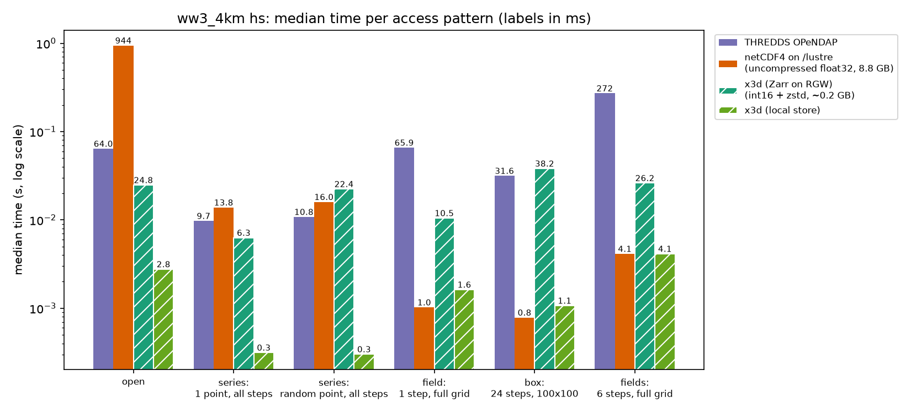

# x3d

xarray backend for the waves.met.no Zarr data store (see `../wave-world`), with a Rust core
(HTTP range reads, Zarr v3 shard indexes, zstd, hyperslab assembly; GIL released, parallel requests).

```python
import xarray as xr
ds = xr.open_dataset("x3d+https://rgw.met.no/<project>:waves-ww3/ww3_4km")  # the x3d+ prefix selects the engine
ds.hs.isel(rlat=500, rlon=300).values   # point series: served from ts.zarr
ds.hs.isel(time=10).values              # field: served from map.zarr
xr.open_dataset("x3d+https://.../ww3_4km", layout="ov")   # coarse 1/4 grid (block means), lossy
```

Opening reads `latest.json`, `dataset.json` and the consolidated metadata of `ts.zarr` / `map.zarr`
(a few small requests); data is lazy. `data.met.no/ww3_4km` will work the same once the store is served there.

URL: `x3d+<http(s)|file URL or path>[?run=<id>&layout=auto|ts|map|ov]` (kwargs `run=`, `layout=` win).
The `x3d+` prefix selects the engine; without it (plain path or URL) pass `engine="x3d"`.

- **Layout choice** (`layout="auto"`): per read, the Rust core plans requests and bytes for `ts` and `map`
  from the chunk geometry and `x3d.layout.choose` picks the cheapest. Both are exact, so the choice is invisible.
  `ov` is lossy (block means) and never chosen implicitly. `logging.getLogger("x3d")` at DEBUG shows the choice.
- Data decodes to float32 (int16 + `scale_factor` + `_FillValue` via normal CF decoding); `latitude`/`longitude` are coordinates.
- Absent shards/chunks (land) read as fill without data transfer.

Prototype limits / next steps: only the latest run (no best-forecast aggregate across runs yet); no write
support; only the codecs the pipeline writes (`sharding_indexed`, `bytes`, `zstd`, `crc32c`); no read coalescing,
caching of decoded chunks or overview-to-field refinement.

## Benchmark: THREDDS vs x3d



Regenerate (needs network; overwrites the image, then commit it):

    pytest --benchmark-enable --benchmark-only --benchmark-columns=min,median,mean,rounds

## Develop

Create the conda env from `environment.yml` (Rust, maturin, pytest, xarray, zarr, ...):

    mamba env create -f environment.yml
    conda activate x3d
    maturin develop --release     # builds src/ into python/x3d/_core*.so
    cargo test                    # Rust unit tests (hand-encoded shards, corruption, missing chunks)
    pytest                        # everything below
    pytest -m "not rgw and not store"   # offline
    pytest --benchmark-enable --benchmark-only   # THREDDS vs x3d benchmark -> docs/thredds_vs_x3d.png

Tests (`tests/`):

- Synthetic store written with zarr-python (same layout/codecs as wave-world, both shard index locations) under
  `tmp`; values are checked against numpy and against zarr-python itself.
- A local HTTP server with Range support that logs requests: asserts open cost and requests per access pattern.
- `-m rgw`: integration against the public RGW bucket (`X3D_RGW_URL` overrides; skipped if unreachable).
- `-m store`: against the local wave-world store (`X3D_TEST_STORE`, default `../wave-world/store/ww3_4km`).
- `tests/test_benchmark.py` (marked `rgw`): pytest-benchmark of the same ww3_4km `hs` data through four backends:
  THREDDS OPeNDAP (`X3D_THREDDS_URL`), the NetCDF file on `/lustre` read with netCDF4 (newest
  `ww3_4km_<date>T00Z.nc` below `X3D_LUSTRE_ROOT`, or `X3D_LUSTRE_FILE`), x3d on RGW and x3d on the local store
  (`x3d+file://`, `X3D_TEST_STORE`); unavailable ones are skipped. Scenarios: open, point series (fixed and random
  point), field, box, several fields. Each round opens the dataset anew (not timed). The two file-based backends
  are only cold in the first round (later rounds hit the OS page cache), so read them as best case. The /lustre file is uncompressed float32 (8.8 GB, one field per chunk), so netCDF4 does
  no decoding and is not a like-for-like comparison with the int16 + zstd store (~0.2 GB); the plot legend says so. The local x3d reads are CPU-bound (zstd) on a thread pool, and the pause between
  rounds roughly doubles them (a 100x100x24 box: 1.0 ms back to back, 2.2 ms after a 0.3 s pause; 7 ms on one
  thread), so the plot is the idle-start figure. Benchmarking is
  disabled by default (`addopts = --benchmark-disable`: each case runs once as a plain test); `--benchmark-enable`
  measures, `--benchmark-only` runs only the benchmarks, and the bar plot goes to `docs/` (`X3D_BENCH_OUT`; rounds
  via `X3D_BENCH_ROUNDS`). Separate tests check THREDDS and the lustre file (when from the same model run) return
  the same numbers as x3d.
- `tests/test_microbench.py` (`-m "rgw or store" -s`): where a read spends its time, from `Array.read_profiled`
  (index requests, store fetches, zstd decode, copy into the output; thread-time summed, next to wall time), against
  RGW and the local store. On RGW the wall time is fetching; decode + copy are a few ms even for six full fields,
  so decoding is not the bottleneck. `X3D_THREADS` sets the size of the I/O + decode pool (default max(16, cores)).
